<!-- ════════════════════════  HEADER  ════════════════════════ -->
<p align="center">
  
</p>

<p align="center">
  <a href="https://github.com/phani06041">
    
  </a>
</p>

<p align="center">
  <a href="mailto:phanindra.maddipatla@gmail.com"></a>
  
  <a href="https://github.com/phani06041?tab=followers"></a>
</p>

<!-- ════════════════════════  ABOUT  ════════════════════════ -->
<h2>🧬 About me</h2>

<table>
<tr>
<td width="58%" valign="top">

```python
class Phanindra:
    role       = "Software Engineer"
    based_in   = "Bengaluru, India 🇮🇳"
    building   = ["AI agents", "LLM + RAG apps", "self-improving systems"]
    toolbox    = {
        "code":  ["Python", "JavaScript", "TypeScript", "C"],
        "ai":    ["LLMs", "RAG", "SLMs", "Genetic Algorithms"],
        "web":   ["FastAPI", "React", "Node.js", "Vite"],
        "data":  ["ChromaDB", "MongoDB", "MySQL", "Redis"],
    }
    motto      = "Think. Build. Learn. Repeat."

    def currently(self):
        return "Shipping agents that get better every time they run 🔁"
```

</td>
<td width="42%" valign="top">

- 🚦 Taught an agent to time the signals at **Silk Board** — it rewrote its own playbook from **38 → 96**
- 🩸 Built **Blood Bridge** to turn WhatsApp blood forwards into verified, closed-loop requests
- 🕵️ Made a **self-privacy scanner** that maps your public digital footprint
- 🏆 Regular at hackathons — I like a deadline and a hard problem
- 🤝 Open to collaborations on AI, agents and open source

</td>
</tr>
</table>

<!-- ════════════════════════  PROJECTS  ════════════════════════ -->
<h2>🚀 Featured builds</h2>

<table>
<tr>
<td width="50%" valign="top">

### 🚦 [Silk Board Fixer](https://github.com/phani06041/silk-board-fixer)
An agent that plans signal timings at Bengaluru's most infamous junction, reads a second-by-second simulator report, then **rewrites its own playbook** and runs again.

**Run 1 → Run 4: `38.3 → 96.1`** on frozen scenarios (incl. IPL night & monsoon rush).

  

</td>
<td width="50%" valign="top">

### 🩸 [Blood Bridge](https://github.com/phani06041/blood-bridge)
Turns an urgent blood request into a **verified, live hunt** across nearby blood banks and opt-in donors in Bengaluru — inside one ASI:One chat. Blocks "processing fee" scams and tracks each request until fulfilled.

   

</td>
</tr>
<tr>
<td width="50%" valign="top">

### 🕵️ [Digital Footprints](https://github.com/phani06041/digital-footprints)
A self-privacy scanner: searches the public web for you, links every finding to its source, estimates identity-match confidence, scores exposure risk and suggests fixes.

<a href="https://digital-footprints.onrender.com/"></a> <a href="https://youtu.be/5gLTz1Skw8k"></a> 

</td>
<td width="50%" valign="top">

### 🌟 [AI Resume Pro](https://github.com/phani06041/AI_Resume_optimiser)
Parses a résumé, scores it against a job description and rewrites it — with a built-in AI career coach and automatic fallback between Gemini and OpenAI when rate limits hit.

<a href="https://phani06041.github.io/AI_Resume_optimiser/"></a>  

</td>
</tr>
<tr>
<td width="50%" valign="top">

### 🛡️ [Fraud Sentinel](https://github.com/phani06041/fraud-detection-slm)
Fraud detection pipeline: data forensics → prompt-injection defence → behavioural features → Isolation Forest + a small language model, with strict JSON validation and a deterministic fallback.

  

</td>
<td width="50%" valign="top">

### 🔮 [RAG Knowledge Bot](https://github.com/phani06041/rag-knowledge-bot)
A fully local, privacy-first RAG chatbot. Drop in PDFs, TXT or DOCX and ask questions — with per-file filtering, Redis caching, auto-ingest and session memory.

   

</td>
</tr>
</table>

<details>
<summary><b>✨ More things I've made</b></summary>
<br/>

| Project | What it is |
|---|---|
| 🎆 [ParticleText Reimagined](https://github.com/phani06041/particletext-reimagined) | Interactive particle-text experience in vanilla JS + Canvas — [live demo](https://phani06041.github.io/particletext-reimagined/) |
| 🤖 [Maxx Discord Bot](https://github.com/phani06041/maxx-discord-bot) | Context-aware Discord bot that answers from manuals with semantic search and local LLMs |
| ⏱️ [Productivity Tracker](https://github.com/phani06041/Productivity-Tracking-Tool) | MERN app to paint your day hour-by-hour, track spend and export CSV / Excel / PDF |
| 🐦 [AI Learns Flappy Bird](https://github.com/phani06041/AI-LEARNS-TO-PLAY-FLAPPY-BIRD) | A genetic algorithm that evolves birds until they master the game |

</details>

<!-- ════════════════════════  STACK  ════════════════════════ -->
<h2>⚡ Tech stack</h2>

<p align="center">
  <br/>
  <br/>
  
</p>

<!-- ════════════════════════  STATS  ════════════════════════ -->
<h2>📊 GitHub universe</h2>

<p align="center">
  
  
</p>

<p align="center">
  
</p>

<p align="center">
  
</p>

<!-- ════════════════════════  SNAKE  ════════════════════════ -->
<p align="center">
  <picture>
    <source media="(prefers-color-scheme: dark)" srcset="https://raw.githubusercontent.com/phani06041/phani06041/output/github-contribution-grid-snake-dark.svg" />
    <source media="(prefers-color-scheme: light)" srcset="https://raw.githubusercontent.com/phani06041/phani06041/output/github-contribution-grid-snake.svg" />
    
  </picture>
</p>

<!-- ════════════════════════  FOOTER  ════════════════════════ -->
<p align="center">
  <b>💡 Think. Build. Learn. Repeat.</b><br/>
  <i>Every commit is a step forward. 🚀</i>
</p>

<p align="center">
  
</p>
